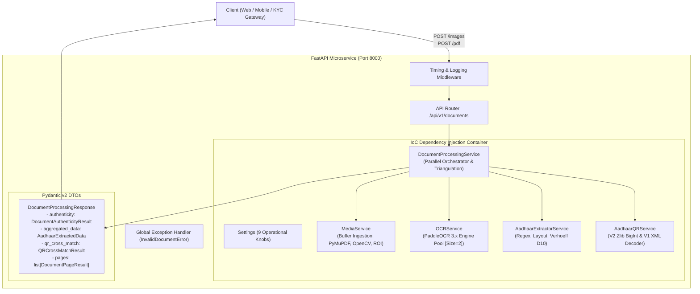
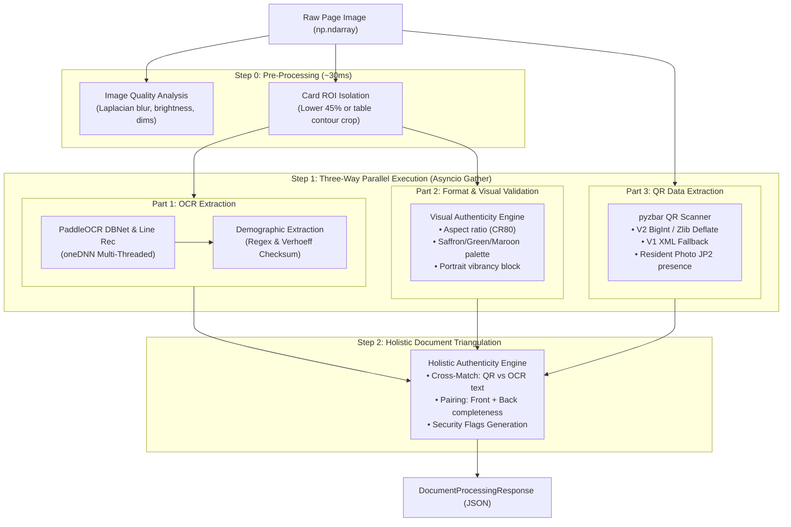

# Aadhaar Validation & Extraction Service — System Architecture Document

## 1. Executive Summary

The **Aadhaar Validation & Extraction Service** is a privacy-first, local microservice designed to ingest identity documents (Aadhaar front/back images and multi-page e-Aadhaar PDFs), perform image quality analysis, execute deep-learning Optical Character Recognition (OCR), decode embedded UIDAI Secure QR codes, and run multi-factor authenticity triangulation without external network dependencies.

### Core Architectural Principles
- **In-Memory Privacy by Design**: Documents are ingested, decoded, processed, and validated purely in volatile RAM. Original files, intermediate arrays, and resident PII are never persisted to disk.
- **Side-Aware Authenticity**: Acknowledges that Aadhaar is an asymmetric two-sided document (Front holds the resident portrait; Back holds the Secure QR code). Authenticity is evaluated at both the individual side level and via document-level triangulation.
- **Three-Way Parallel Pipeline**: For every page, OCR extraction, format/visual verification, and QR decoding execute simultaneously in asynchronous thread pools.
- **Cryptographic & Data Cross-Matching**: Compares high-density QR payload data against printed OCR text to catch digital manipulation and tampering.
- **Modular & Loosely Coupled**: Built with `dependency-injector` container for component swappability, isolated singleton lifecycles, and rapid test mocking.

---

## 2. High-Level System Architecture

The following diagram outlines the system topology from HTTP ingestion through the three-way parallel engine to the final structured response:



---

## 3. The Three-Way Parallel Processing Pipeline

For each document page, the pipeline splits into three concurrent branches executed via `asyncio.gather()`, running across a bounded worker pool:



---

## 4. Two-Tier Authenticity Architecture

### Why Page-Wise Evaluation Alone Is Insufficient
Aadhaar is fundamentally an **asymmetric identity card**:
- The **Front Side** has the resident portrait photo, official tricolor palette, bilingual Government typography, and Name/DOB. It never has a QR code.
- The **Back Side** has the high-density QR code and address block. It never has a portrait photo.
- In e-Aadhaar letters, both cutouts appear on a single A4 page.

Evaluating pages in isolation leads to false negatives (penalizing a valid front for missing a QR) or false positives (accepting a counterfeit front paired with a legitimate back).

### The Two-Tier Solution
1. **Tier 1 (Page-Level Feature Extraction)**:
   - Collects visual signals: color saturation in Aadhaar bands, aspect ratio, QR presence, portrait presence.
2. **Tier 2 (Document-Level Holistic Triangulation)**:
   - **Completeness Check**: Checks if both front and back markers exist (`FULL_SET`, `FRONT_ONLY`, `BACK_ONLY`).
   - **Tampering & Cross-Validation**: Compares the 4 demographic anchor fields (Name, DOB, Gender, and Aadhaar Last-4 digits) between the QR payload and OCR text.
   - **Verdict Assignment**:
     - `AUTHENTIC_COMPLETE_PAIR`: Front + Back verified and 100% cross-matched.
     - `AUTHENTIC_FRONT_ONLY`: Valid front card (portrait/graphics + palette + Verhoeff); back missing.
     - `AUTHENTIC_BACK_ONLY`: Valid back card (QR + address); front missing.
     - `TAMPERING_DETECTED`: QR code payload contradicts printed OCR text (Fraud Alert).
     - `SUSPECTED_FAKE_DOCUMENT`: Plain typed canvas, synthetic text, or missing all markers.

---

## 5. Mathematical & Cryptographic Specifications

### 5.1. Verhoeff Checksum Algorithm ($D_5$ Dihedral Group)
The 12-digit Aadhaar number is verified using the Verhoeff algorithm, which detects all single-digit errors and all transposition errors between adjacent digits.

Given a number $a_{12} a_{11} \dots a_2 a_1$ (where $a_1$ is the check digit):
$$c = \left( \sum_{i=1}^{12} d\left(c_{i-1}, \, p\left((i-1) \bmod 8, \, a_i\right)\right) \right) = 0$$

Where $d(j, k)$ is the multiplication table in $D_5$ and $p(pos, val)$ is the permutation table. If $c = 0$, the number is mathematically valid.

### 5.2. UIDAI Secure QR Code Format (V2 / V3)
UIDAI encodes resident data as a compressed binary payload formatted as a large decimal BigInteger string:
1. **BigInteger Decoding**: Converted to bytes via $\text{int}(\text{data}).\text{to\_bytes}(L, \text{'big'})$.
2. **Decompression**: Decompressed via standard Deflate/Zlib with `16 + zlib.MAX_WBITS`.
3. **Delimiter Parsing**: Fields are delimited by byte `0xFF` (`255`):
   - `[0]`: Email/Mobile bitmask.
   - `[1]`: Reference ID (Prefix 4 digits = Last 4 digits of Aadhaar number; Suffix = timestamp).
   - `[2]`: Resident Name.
   - `[3]`: Date of Birth (`DD-MM-YYYY`).
   - `[4]`: Gender (`M` / `F` / `T`).
   - `[5]`: Care Of (`S/O`, `D/O`, `W/O`).
   - `[6-16]`: District, Landmark, House, Location, PIN code, Post Office, State, VTC.
   - `[17+]`: JPEG 2000 (JP2) resident photograph byte stream.
   - `[Tail]`: 256-byte RSA digital signature.

---

## 6. Response Structure Specification

The API returns a structured, strictly-typed Pydantic model (`DocumentProcessingResponse`):

```json
{
  "processing_status": "SUCCESS",
  "document_type": "E_AADHAAR",
  "authenticity_status": "VERIFIED_AUTHENTIC_CARD",
  "processing_time_seconds": 3.826,
  "message": "Image processing, OCR, and multi-factor authenticity verification completed successfully.",

  "authenticity": {
    "verdict": "AUTHENTIC_COMPLETE_PAIR",
    "confidence_score": 0.99,
    "completeness": "FULL_SET",
    "is_tampered": false,
    "has_front_face_or_portrait": true,
    "has_back_secure_qr": true,
    "has_valid_verhoeff_checksum": true,
    "has_official_color_palette": true,
    "has_valid_card_geometry": true,
    "qr_ocr_data_matched": true,
    "security_flags": [
      "PORTRAIT_BIOMETRIC_PRESENT",
      "SECURE_QR_PRESENT",
      "VERHOEFF_CHECKSUM_VALID",
      "OFFICIAL_PALETTE_DETECTED",
      "CARD_GEOMETRY_CR80_VALID",
      "QR_DEMOGRAPHICS_MATCHED",
      "DOCUMENT_FULL_SET_COMPLETE"
    ]
  },

  "aggregated_data": {
    "aadhaar_number": "5134 5777 0655",
    "is_aadhaar_number_valid": true,
    "is_masked": false,
    "name": "Sahil Sahebrao Mankar",
    "dob": "17/11/2001",
    "gender": "MALE",
    "address": "Address: S/O Sahebrao Mankar, gavthan, taluka- ambegaon, Pargaon Tarf Khed, Pune, Maharashtra, 410512",
    "pin_code": "410512",
    "document_side": "FULL_PAGE"
  },

  "qr_cross_match": {
    "cross_match_status": "MATCHED",
    "match_confidence": 1.0,
    "name_matched": true,
    "dob_matched": true,
    "gender_matched": true,
    "aadhaar_last4_matched": true,
    "pin_code_matched": true,
    "mismatches": [],
    "qr_data": {
      "format": "SECURE_QR_V2",
      "reference_id": "065520210713221106490",
      "aadhaar_last4": "0655",
      "name": "Sahil Sahebrao Mankar",
      "dob": "17/11/2001",
      "gender": "MALE",
      "care_of": "S/O Sahebrao Mankar",
      "pin_code": "410512",
      "district": "Pune",
      "state": "Maharashtra",
      "address": "S/O Sahebrao Mankar, gavthan  taluka- ambegaon, Pargaon Tarf Khed, Pune, Maharashtra, 410512",
      "has_photo": true
    }
  },

  "pages": [
    {
      "page_number": 1,
      "image_quality": {
        "width": 2105,
        "height": 1488,
        "blur_score": 142.3,
        "brightness": 158.4,
        "status": "GOOD",
        "warnings": []
      },
      "visual_authenticity": {
        "is_valid_aadhaar_card_image": true,
        "authenticity_score": 80,
        "aspect_ratio": 1.415,
        "qr_detected": false,
        "has_aadhaar_palette": true,
        "has_photo_or_graphics": true,
        "checks_passed": [
          "VALID_ASPECT_RATIO",
          "AADHAAR_PALETTE_DETECTED",
          "GRAPHICS_OR_PORTRAIT_REGION_DETECTED"
        ]
      },
      "ocr": {
        "status": "SUCCESS",
        "full_text": "Government of India Sahil Sahebrao Mankar DOB: 17/11/2001 Male 5134 5777 0655",
        "lines": [
          {
            "text": "Government of India",
            "confidence": 0.985,
            "bbox": [487, 82, 1043, 150]
          }
        ]
      },
      "extracted_data": {
        "aadhaar_number": "5134 5777 0655",
        "is_aadhaar_number_valid": true,
        "name": "Sahil Sahebrao Mankar",
        "dob": "17/11/2001",
        "gender": "MALE",
        "document_side": "FRONT"
      }
    }
  ]
}
```

---

### 6.1. Front-Only Upload Response Example

When only the front side of a card is uploaded:

```json
{
  "processing_status": "SUCCESS",
  "document_type": "AADHAAR_FRONT",
  "authenticity_status": "VERIFIED_CARD_IMAGE",
  "processing_time_seconds": 1.45,
  "message": "Image processing, OCR, and multi-factor authenticity verification completed successfully.",
  "authenticity": {
    "verdict": "AUTHENTIC_FRONT_ONLY",
    "confidence_score": 0.90,
    "completeness": "FRONT_ONLY",
    "is_tampered": false,
    "has_front_face_or_portrait": true,
    "has_back_secure_qr": false,
    "has_valid_verhoeff_checksum": true,
    "has_official_color_palette": true,
    "has_valid_card_geometry": true,
    "qr_ocr_data_matched": null,
    "security_flags": [
      "PORTRAIT_BIOMETRIC_PRESENT",
      "VERHOEFF_CHECKSUM_VALID",
      "OFFICIAL_PALETTE_DETECTED",
      "CARD_GEOMETRY_CR80_VALID"
    ]
  },
  "aggregated_data": {
    "aadhaar_number": "5134 5777 0655",
    "is_aadhaar_number_valid": true,
    "name": "Sahil Sahebrao Mankar",
    "dob": "17/11/2001",
    "gender": "MALE",
    "address": null,
    "pin_code": null,
    "document_side": "FRONT"
  },
  "qr_cross_match": {
    "cross_match_status": "QR_NOT_FOUND",
    "match_confidence": 0.0,
    "qr_data": null
  }
}
```

---

## 7. Performance & Optimization Profile

- **Engine Pool Concurrency**: Maintains a queue of worker engines (`ocr_pool_size=2`), enabling simultaneous multi-page OCR across separate physical cores.
- **Intel oneDNN Acceleration**: Configured with `OMP_NUM_THREADS=6` and `MKL_NUM_THREADS=6` on 12-core hosts.
- **DPI & Quality Balance**: Renders PDFs at `150` DPI with a `960` pixel DBNet detection envelope, ensuring crisp recognition of fine Hindi ligatures, date numbers, and PIN codes without downsampling artifacts.
- **Latency Benchmark on e-Aadhaar PDF**:
  - Baseline (Sequential, Server Det, 1 core): **`68.80s`**
  - Current Optimized (Mobile Det, Pool=2, 3-Way Parallel, oneDNN=6): **`3.82s`** (18x speedup).
