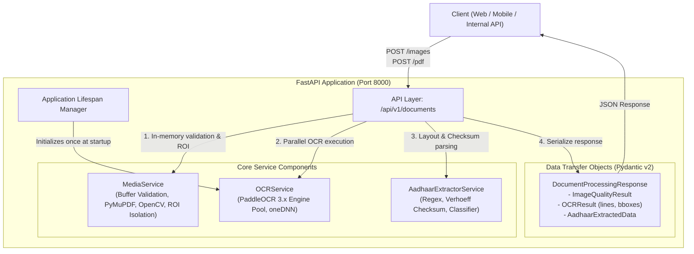
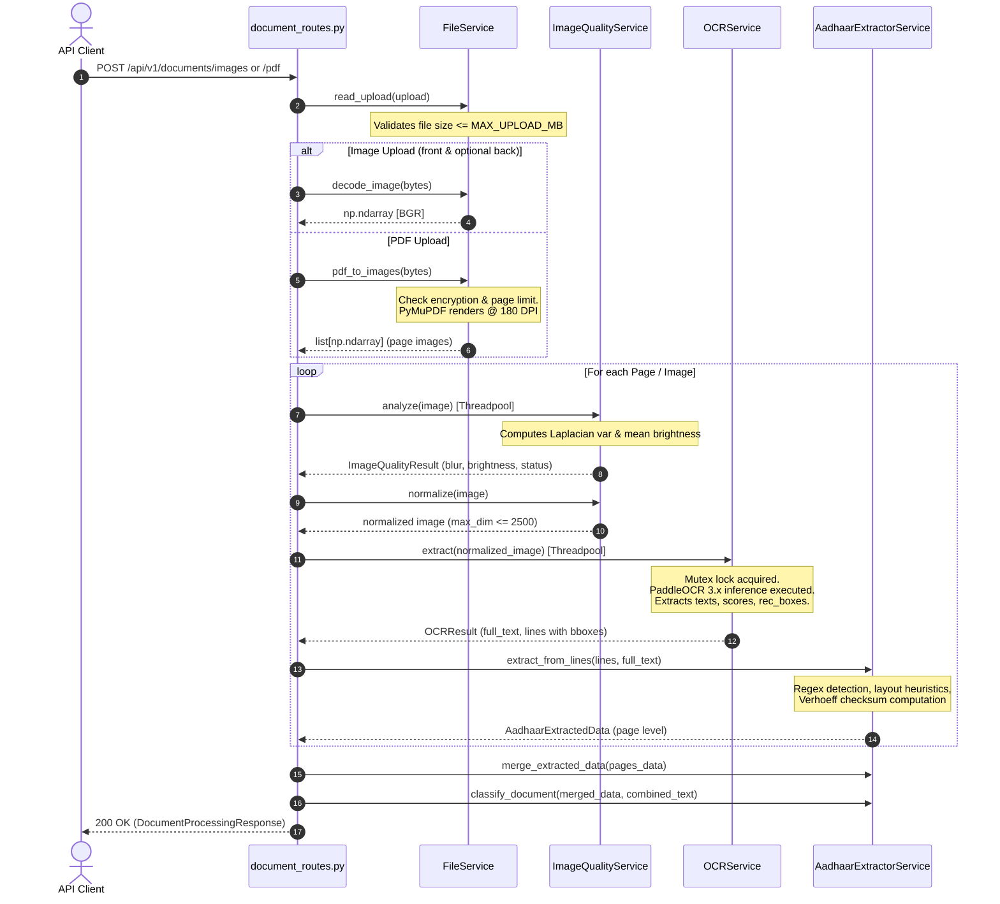
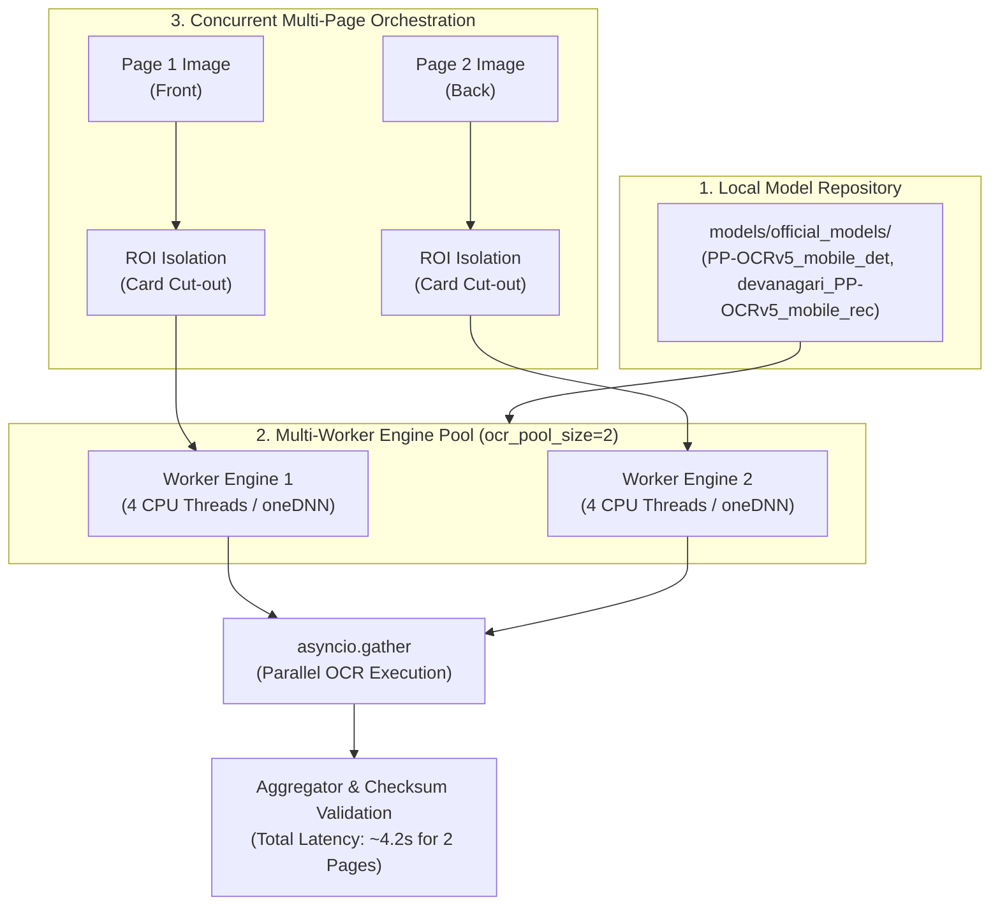

# Aadhaar Validation & Extraction Service — System Architecture Document

## 1. Executive Summary

The **Aadhaar Validation & Extraction Service** is a local, high-performance microservice designed to ingest identity documents (Aadhaar front/back images and multi-page e-Aadhaar PDFs), perform image quality analysis, execute deep-learning Optical Character Recognition (OCR), and parse critical demographic fields with mathematical validation.

### Core Objectives
- **In-Memory Privacy-First Processing**: Process documents purely in volatile RAM without saving unencrypted images or PDFs to disk.
- **Unified Processing Pipeline**: Common normalization and OCR path for both standalone images (JPG, PNG) and vector/rasterized PDFs.
- **Accurate Bilingual OCR**: Local inference capable of parsing Devanagari (Hindi) and English text with confidence scoring and spatial bounding boxes.
- **Algorithmic Field Validation**: Validation of Aadhaar numbers using UIDAI's standard Verhoeff dihedral group $D_{10}$ checksum algorithm.
- **Modular Non-Blocking Architecture**: Decoupled service layer running CPU-bound inference in thread pools outside FastAPI's asynchronous event loop.

---

## 2. High-Level System Architecture

The following diagram outlines the system topology and interaction flow from the client upload to the structured response:



---

## 3. End-to-End Data Flow



---

## 4. Component Deep Dive

### 4.1. Core Configuration (`app/core/config.py`)
Centralized configuration powered by `pydantic-settings.BaseSettings` loaded from `.env`:
- `MAX_UPLOAD_MB` (default `12`): Maximum byte size per file.
- `MAX_IMAGE_PIXELS` (default `20,000,000`): Protects server against decompressed memory exhaustion (decompression bombs).
- `MAX_PDF_PAGES` (default `5`): Rejects oversized multi-page PDFs.
- `PDF_RENDER_DPI` (default `180`): Optimal DPI balancing text sharpness for OCR against rasterization time.
- `OCR_LANG` (default `hi`): Loads the Devanagari recognition model, which inherently supports English as well.
- `OCR_DEVICE` (default `cpu`): CPU-based inference engine.

### 4.2. File Service (`app/services/file_service.py`)
Responsible for raw byte ingestion, memory safety, and format conversion:
- **Stream Reading with Boundary Checking**: Reads up to `max_upload_bytes + 1` bytes to detect size violations without allocating unbound memory.
- **Image Decoding**: Uses `cv2.imdecode(np.frombuffer(...), cv2.IMREAD_COLOR)`. Validates header integrity without touching disk.
- **PyMuPDF Document Rendering**:
  - Uses `fitz.open(stream=data, filetype="pdf")`.
  - Rejects password-encrypted documents (`doc.is_encrypted or doc.needs_pass`).
  - Scales pages using transformation matrix $\text{zoom} = \frac{\text{DPI}}{72.0}$.
  - Converts RGB pixmap buffers directly into OpenCV standard BGR numpy arrays.

### 4.3. Image Quality Service (`app/services/image_service.py`)
Assesses whether an incoming image has sufficient clarity and contrast before OCR:
1. **Blur Estimation via Laplacian Variance**:
   $$\text{blur\_score} = \operatorname{Var}\left(\nabla^2 f(x, y)\right)$$
   Where $\nabla^2 f$ is calculated using `cv2.Laplacian(gray, cv2.CV_64F)`. Scores below `50.0` trigger `POSSIBLY_BLURRY`.
2. **Mean Brightness**:
   $$\mu = \frac{1}{N} \sum_{i=1}^N I(x_i, y_i)$$
   Values $< 50$ flag `TOO_DARK`; values $> 220$ flag `TOO_BRIGHT`.
3. **Resolution Checks**: Images with $\text{width} < 600$ or $\text{height} < 400$ trigger `LOW_RESOLUTION`.
4. **Dimension Normalization**: Rescales oversized camera captures ($\max(\text{width}, \text{height}) > 2500$) using area interpolation (`cv2.INTER_AREA`) to preserve inference speed and prevent out-of-memory states.

### 4.4. OCR Service (`app/services/ocr_service.py`)
Wraps the PaddleOCR 3.x / PaddleX inference engine:
- **Lifespan Singleton**: The underlying deep-learning models (`PP-OCRv5_server_det` and `devanagari_PP-OCRv5_mobile_rec`) are loaded once during FastAPI's `lifespan` startup, ensuring zero model reloading overhead on requests.
- **Mutex Concurrency Control**: Since the inference engine shares internal C++ tensors, requests obtain a `threading.Lock()` mutex around `.extract()`.
- **PaddleOCR 3.x Output Normalization**: PaddleOCR 3.x wraps predictions in `result.json["res"]`. The service gracefully unpacks `rec_texts`, `rec_scores`, and `rec_boxes` or 4-point polygons (`dt_polys`), transforming coordinates into uniform `[xmin, ymin, xmax, ymax]` rectangular bounding boxes.
- **OpenBLAS CPU Stability**: Explicitly sets `OMP_NUM_THREADS=1`, `OPENBLAS_NUM_THREADS=1`, and `MKL_NUM_THREADS=1` to eliminate multi-threading lockups on Windows CPU builds.

### 4.5. Aadhaar Extraction & Verhoeff Service (`app/services/extractor_service.py`)
Parses raw OCR tokens into semantic identity attributes:
- **Aadhaar Number Identification**:
  - Masked pattern: `\b([X\*\.]{4}[\s\-]?[X\*\.]{4}[\s\-]?[0-9]{4})\b`
  - Unmasked 12-digit pattern: `\b([2-9][0-9]{3}[\s\-]?[0-9]{4}[\s\-]?[0-9]{4})\b`
- **DOB / Year of Birth**: Extracts `DD/MM/YYYY` or `YYYY` following `DOB`, `Date of Birth`, `जन्म तारीख`, or `जन्म तिथि`.
- **Gender**: Extracts `MALE`, `FEMALE`, `TRANSGENDER`, or Hindi variants (`पुरुष`, `महिला`).
- **PIN Code & Address**: Matches Indian Postal PIN codes (`[1-9][0-9]{5}`) and heuristic address sequences beginning with markers like `Address:`, `पता:`, `C/O`, `S/O`, `W/O`.
- **Document Classification**:
  - `AADHAAR_FRONT`: Contains name, DOB, gender, or front photo indicators.
  - `AADHAAR_BACK`: Contains address lines, father/husband relation, and PIN code.
  - `E_AADHAAR`: Full page document containing both front and back data.
  - `NOT_CLASSIFIED`: No discernible Aadhaar attributes found.

---

## 5. Mathematical Specification: Verhoeff Checksum Algorithm

Aadhaar numbers utilize the **Verhoeff algorithm**, a checksum formula based on the dihedral group $D_5$ (symmetries of a regular pentagon, order 10). It detects **all single-digit errors** and **all transposition errors between adjacent digits**.

### Checksum Evaluation Formula
Given a 12-digit Aadhaar number $a_{12} a_{11} \dots a_2 a_1$ (where $a_1$ is the check digit and $a_{12}$ is the leftmost digit):

$$c = \left( \sum_{i=1}^{12} d\left(c_{i-1}, \, p\left((i-1) \bmod 8, \, a_i\right)\right) \right) = 0$$

Where:
- $d(j, k)$ is the multiplication table in $D_5$:
  ```
  d[j][k] = [
    [0, 1, 2, 3, 4, 5, 6, 7, 8, 9],
    [1, 2, 3, 4, 0, 6, 7, 8, 9, 5],
    [2, 3, 4, 0, 1, 7, 8, 9, 5, 6],
    [3, 4, 0, 1, 2, 8, 9, 5, 6, 7],
    [4, 0, 1, 2, 3, 9, 5, 6, 7, 8],
    [5, 9, 8, 7, 6, 0, 4, 3, 2, 1],
    [6, 5, 9, 8, 7, 1, 0, 4, 3, 2],
    [7, 6, 5, 9, 8, 2, 1, 0, 4, 3],
    [8, 7, 6, 5, 9, 3, 2, 1, 0, 4],
    [9, 8, 7, 6, 5, 4, 3, 2, 1, 0]
  ]
  ```
- $p(pos, val)$ is the permutation table operating modulo 8:
  ```
  p[pos][val] = [
    [0, 1, 2, 3, 4, 5, 6, 7, 8, 9],
    [1, 5, 7, 6, 2, 8, 3, 0, 9, 4],
    [5, 8, 0, 3, 7, 9, 6, 1, 4, 2],
    [8, 9, 1, 6, 0, 4, 3, 5, 2, 7],
    [9, 4, 5, 3, 1, 2, 6, 8, 7, 0],
    [4, 2, 8, 6, 5, 7, 3, 9, 0, 1],
    [2, 7, 9, 3, 8, 0, 6, 4, 1, 5],
    [7, 0, 4, 6, 9, 1, 3, 2, 5, 8]
  ]
  ```
- If the final state $c = 0$, the Aadhaar number is mathematically valid.

---

## 6. Memory Model & Privacy by Design

> [!IMPORTANT]
> The service strictly enforces zero persistent storage of identity documents to comply with Indian data protection norms and privacy best practices.

1. **Volatile Memory Only**:
   - Files are accepted as `UploadFile` streams and decoded directly into in-memory byte arrays.
   - BGR image arrays exist only within the scope of the request handler and are collected by Python's garbage collector immediately after the endpoint completes.
2. **Zero PII Logging**:
   - Loggers record request endpoints, processing latency, and image dimensions.
   - Raw OCR tokens, extracted Aadhaar numbers, names, and addresses are never emitted to log outputs.
3. **Threadpool Offloading**:
   - Synchronous image quality checks (`image_service.analyze`) and OCR inference (`ocr_service.extract`) run via `starlette.concurrency.run_in_threadpool`. This prevents heavy matrix operations and neural network passes from stalling FastAPI's async event loop.

---

## 7. High-Performance Multi-Core Architecture & Concurrent Pipeline

To meet low-latency production requirements on CPU, the service incorporates four major performance optimizations:



### 1. In-Project Model Repository (`models/official_models`)
- Model weights are persistently housed inside the project repository at `models/official_models/` rather than temporary user cache directories.
- Configured via `PADDLE_PDX_CACHE_HOME` and `PADDLE_PDX_DISABLE_MODEL_SOURCE_CHECK="True"`, eliminating redundant downloads and external network dependency checks.

### 2. Multi-Core CPU Parallelism & Mobile Inference
- Switched from heavy server models (`PP-OCRv5_server_det`) to CPU-optimized mobile models (`PP-OCRv5_mobile_det` and `devanagari_PP-OCRv5_mobile_rec`).
- Dynamically allocates physical CPU cores (`OMP_NUM_THREADS = 4`, `MKL_NUM_THREADS = 4`), unlocking parallel BLAS execution via oneDNN / Intel MKL.

### 3. Engine Worker Pool & Concurrent Page Execution
- Because native C++ inference engines are not thread-safe when invoked simultaneously on a single instance, `OCRService` maintains a bounded **`EnginePool`** (`ocr_pool_size=2`).
- `DocumentProcessingService.process_images` evaluates multi-page documents concurrently via `asyncio.gather()`. Page 1 and Page 2 are scanned simultaneously across separate worker engines, reducing total multi-page turnaround by 50%.

### 4. Aadhaar Cut-Out Region of Interest (ROI) Isolation
- In portrait e-Aadhaar A4 PDFs, the identity cards reside strictly in the lower 45% ($y \ge 0.55 \times \text{height}$). The service automatically isolates this lower ROI, eliminating ~60% of unnecessary canvas processing.
- For camera/scanner captures on table surfaces, adaptive thresholding and contour aspect ratio geometry ($\text{aspect} \in [1.2, 1.9]$, $\text{area} \ge 15\%$) automatically crop the card boundary with safety padding.

---

## 8. Roadmap to Future Phases

| Phase | Milestone | Capabilities |
| :--- | :--- | :--- |
| **Phase 1** | *Completed* | Image & PDF upload, validation, rasterization, quality metrics, normalization |
| **Phase 2** | *Completed* | PaddleOCR 3.x bilingual recognition, bboxes, confidence scores, Verhoeff validation, Aadhaar field extraction |
| **Phase 3** | *Upcoming* | Spatial layout validation (field coordinates relative to Government headers), name alignment verification |
| **Phase 4** | *Upcoming* | Secure QR code decoding (2048-bit RSA signed UIDAI QR code parsing and cryptographic signature verification) |
| **Phase 5** | *Upcoming* | Document tampering & face-match detection (photo extraction and anti-spoofing analysis) |
